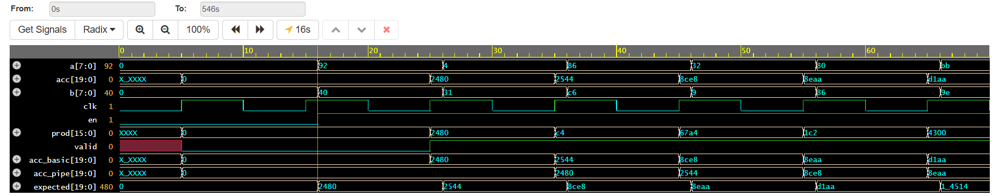

# Pipelined 8-bit MAC Unit (Verilog)

An 8-bit multiply-accumulate (MAC) unit in two versions:
a single-cycle one and a 2-stage pipelined one.

## Files
- design.sv: both MAC modules (mac_basic, mac_pipe)
- testbench.sv: self-checking testbench

## How it works
The pipelined version splits the work into two stages:
stage 1 multiplies and stores the product, stage 2 adds it
to the running total. A valid flag tracks real data.

## Results
Both versions matched the expected total across 50 random
input pairs. The pipelined output lags by one clock cycle.

## Run it
Simulated on EDA Playground with Icarus Verilog.
Link: (paste your EDA Playground share link here)
